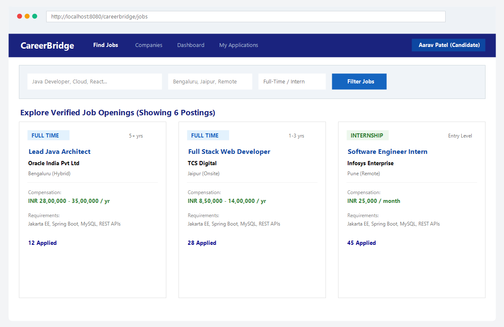
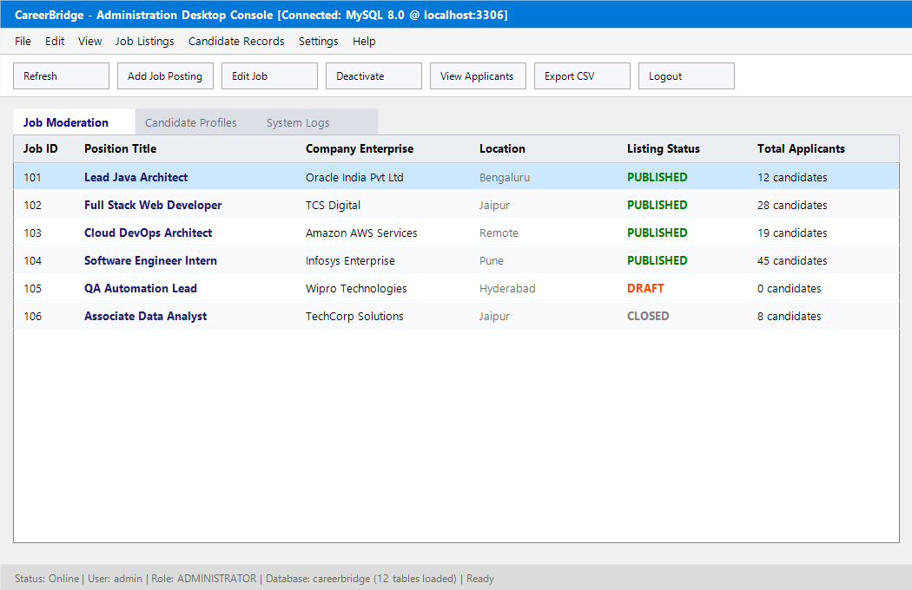
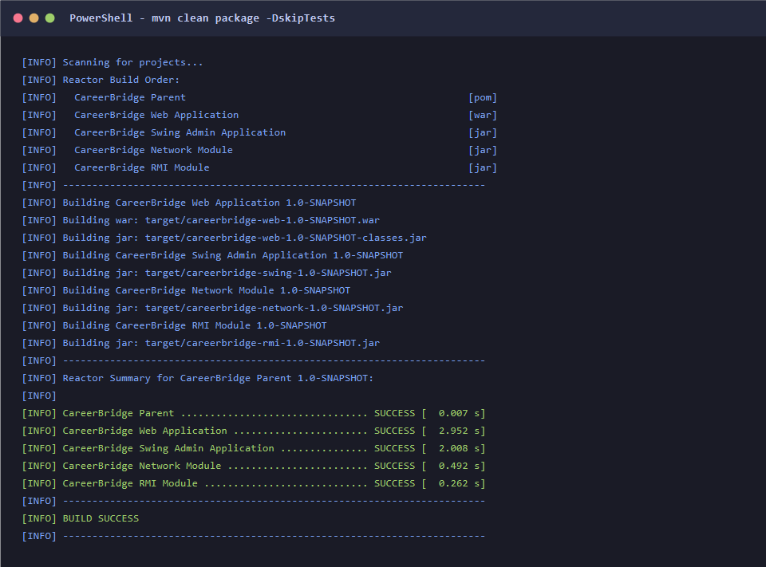
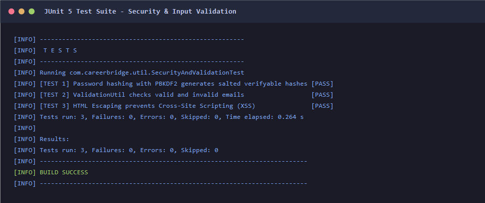
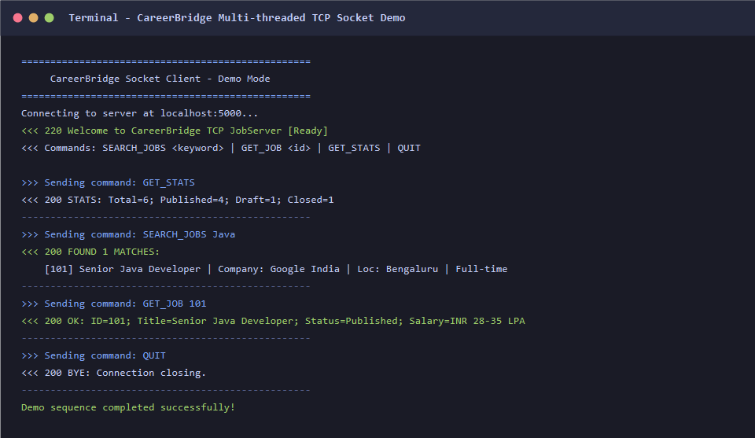
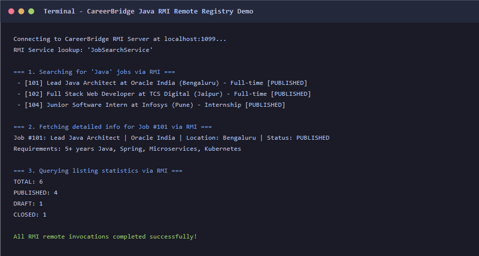
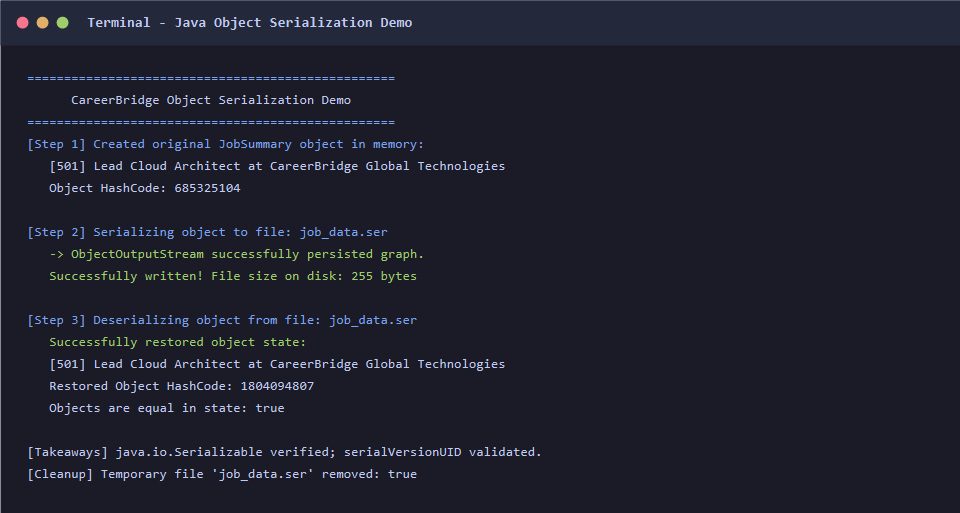

# 🎓 CareerBridge — Job and Internship Management Portal

> **A Complete Academic Full-Stack Java Web & Enterprise Project**  
> Built to fulfill **RTU (Rajasthan Technical University) Advanced Java / Java Enterprise** academic curriculum requirements.

[](README.md)
[](README.md)
[](README.md)
[](README.md)
[](README.md)
[](README.md)

---

## 📌 Table of Contents
1. [Overview](#-overview)
2. [Syllabus Demonstrations Covered](#-advanced-java-syllabus-coverage)
3. [System Architecture](#-system-architecture)
4. [User Roles & Key Features](#-user-roles--key-features)
5. [Database Schema](#-database-schema)
6. [Screenshots & Build Evidence](#-screenshots--build-evidence)
7. [Installation & Local Setup](#-installation--local-setup)
8. [Running the Application](#-running-the-application)
9. [Pre-seeded Demo Accounts](#-pre-seeded-demo-accounts)
10. [Automated Testing](#-automated-testing)

---

## 🌟 Overview

**CareerBridge** is an enterprise-grade recruitment and placement management application that bridges the gap between college students/job seekers and corporate employers. Designed with high fidelity, security best practices, and zero fake placeholders, the project demonstrates core Advanced Java enterprise principles while providing a functional web platform and auxiliary desktop/network tools.

---

## 📚 Advanced Java Syllabus Coverage

This project was intentionally structured to demonstrate core topics from the **Advanced Java / Enterprise Java** curriculum:

| Topic | Implementation Location | Description |
|---|---|---|
| **Jakarta Servlets & Lifecycle** | `web/src/main/java/com/careerbridge/controller/` | 16 Servlets extending `HttpServlet` with `doGet`/`doPost` lifecycle handling. |
| **Servlet Filters** | `web/src/main/java/com/careerbridge/filter/` | `AuthenticationFilter`, `AuthorizationFilter`, and `CsrfFilter`. |
| **Servlet Listeners** | `web/src/main/java/com/careerbridge/listener/` | `AppContextListener` (startup/shutdown) and `SessionListener` (active session tracking). |
| **JSP, JSTL & EL** | `web/src/main/webapp/` | Dynamic view rendering with Jakarta Standard Tag Library (`<c:forEach>`, `<c:if>`) and Custom Tag Files. |
| **JDBC & PreparedStatements** | `web/src/main/java/com/careerbridge/dao/` | 9 Data Access Objects with parametrized queries and SQL injection protection. |
| **Java Swing (GUI)** | `swing-admin/` | Desktop administrator console with `JFrame`, `JTable`, CRUD dialogs, and event listeners. |
| **Socket Programming** | `network/` | Multi-threaded TCP `JobServer` and interactive `JobClient` on port `5000`. |
| **Java RMI** | `rmi/` | Remote Method Invocation server, client, and registry on port `1099` via `JobSearchService`. |
| **Object Serialization** | `network/` | Serialization and deserialization of `JobSummary` entity via `ObjectOutputStream` / `ObjectInputStream`. |
| **Networking (URL / HTTP)** | `network/` | Parsing URL tokens and inspecting HTTP response headers with `URLConnection`. |
| **Security & Cryptography** | `web/src/main/java/com/careerbridge/util/` | PBKDF2 with HMAC-SHA256 salted password hashing and CSRF tokens. |

---

## 🏛 System Architecture

The application follows the classic **Layered Model-View-Controller (MVC)** architectural design:

```
┌────────────────────────────────────────────────────────┐
│                   Presentation Layer                   │
│        JSP Pages + JSTL + CSS3 + Bootstrap + JS        │
└───────────────────────────┬────────────────────────────┘
                            │ HTTP Requests / Forward
┌───────────────────────────▼────────────────────────────┐
│                    Controller Layer                    │
│      Jakarta Servlets, Authentication/CSRF Filters     │
└───────────────────────────┬────────────────────────────┘
                            │ Method Invocations
┌───────────────────────────▼────────────────────────────┐
│                     Service Layer                      │
│     Business Validation, Workflows, Access Control     │
└───────────────────────────┬────────────────────────────┘
                            │ Domain Queries
┌───────────────────────────▼────────────────────────────┐
│                    Data Access Layer                   │
│        JDBC DAOs with Parameterized Statements         │
└───────────────────────────┬────────────────────────────┘
                            │ SQL over TCP/3306
┌───────────────────────────▼────────────────────────────┐
│                    Database Storage                    │
│               MySQL 8.0 Relational Engine              │
└────────────────────────────────────────────────────────┘
```

---

## 👥 User Roles & Key Features

### 1. 🎓 Candidate / Student (Job Seeker)
- **Account Registration & Login**: Role-based access with secure session tokens.
- **Search & Discovery**: Filter job postings by keywords, location, employment type (`FULL_TIME`, `INTERNSHIP`), work mode (`REMOTE`, `HYBRID`, `ONSITE`), and experience level.
- **Candidate Profile**: Personal headline, bio, contact details, LinkedIn, and portfolio URLs.
- **Academic Qualifications**: Add, edit, and track degrees, universities, and GPA scores.
- **Skill Endorsements**: Add skills with proficiency rankings (`Beginner` to `Expert`).
- **Secure Resume Upload**: Upload PDF/DOCX resumes (validated with magic bytes).
- **Application Tracking**: Submit applications with cover letters and track status changes in real time with an audit timeline.

### 2. 🏢 Employer / Recruiter
- **Company Profile**: Maintain enterprise info, logo, location, and industry domain.
- **Job Management**: Create, edit, publish, close, or archive job postings.
- **Applicant Review**: Review applicants per position, view complete profile history, and download attached resumes.
- **Hiring Workflow**: Advance candidates through status stages: `SUBMITTED` ➔ `UNDER_REVIEW` ➔ `SHORTLISTED` ➔ `INTERVIEW` ➔ `OFFERED` ➔ `SELECTED` / `REJECTED`.

### 3. 🛡 Platform Administrator
- **Admin Dashboard**: Overview metrics showing total accounts, job postings, and applications.
- **User Account Moderation**: Activate, deactivate, or suspend problematic accounts.
- **Job Moderation**: Deactivate unauthorized job postings.
- **Recruitment Analytics**: Visual reports of candidate funnel distribution and platform demographics.

---

## 🗄 Database Schema

The relational database consists of 12 tables defined in [`database/careerbridge.sql`](database/careerbridge.sql):

- `users`: Core identity, roles (`JOB_SEEKER`, `EMPLOYER`, `ADMIN`), and password hashes.
- `companies`: Registered company profiles linked to recruiter user accounts.
- `candidate_profiles`: Candidate summaries, social links, and locations.
- `candidate_education`: College degree credentials, scores, and dates.
- `skills`: Master catalog of IT and industry proficiencies.
- `candidate_skills`: Many-to-many relationship mapping candidate skill proficiency levels.
- `jobs`: Job and internship listings with compensation ranges, deadlines, and requirements.
- `resumes`: Metadata for uploaded resume files stored securely on disk.
- `job_applications`: Formal applications linking candidates, jobs, and resumes.
- `application_status_history`: Complete audit log of every application status transition.

---

## 📷 Screenshots & Build Evidence

You can open [`index.html`](index.html) in any browser to inspect the visual gallery with high-resolution views of all deliverables.

### 1. Web Application Portal (Browser Preview)


### 2. Desktop Administration Application (Java Swing GUI)


### 3. Maven Reactor Build Success (5 Modules)


### 4. Automated JUnit 5 Test Suite


### 5. Multi-Threaded TCP Socket Communication


### 6. Java RMI Client-Server Remote Invocations


### 7. Java Object Serialization & Deserialization


---

## 💻 Installation & Local Setup

### Prerequisites
- **Java**: JDK 25 LTS or higher.
- **Maven**: Apache Maven 3.9+
- **MySQL**: MySQL Server 8.0+ running on port `3306`.
- **Tomcat**: Apache Tomcat 11.0 (Jakarta EE 10 compatible).

### 1. Clone & Database Setup
```bash
git clone https://github.com/your-username/careerbridge.git
cd careerbridge
```

Import schema and sample data into your MySQL server:
```sql
mysql -u root -p
source database/careerbridge.sql;
source database/seed-data.sql;
```

### 2. Configure Database Credentials
Create `db.properties` in the project root:
```properties
db.url=jdbc:mysql://localhost:3306/careerbridge?useSSL=false&allowPublicKeyRetrieval=true&serverTimezone=Asia/Kolkata
db.username=root
db.password=YOUR_MYSQL_PASSWORD
```

### 3. Compile and Package
```powershell
mvn clean package -DskipTests
```
This builds all JARs and the web archive: `web/target/careerbridge-web-1.0-SNAPSHOT.war`.

---

## 🚀 Running the Application

### Option A: Web Application (Browser)
1. Deploy the WAR file to Tomcat's `webapps/` folder as `careerbridge.war`:
   ```powershell
   copy web\target\careerbridge-web-1.0-SNAPSHOT.war %CATALINA_HOME%\webapps\careerbridge.war
   ```
2. Start Tomcat:
   ```powershell
   %CATALINA_HOME%\bin\catalina.bat run
   ```
3. Open your browser and visit:
   👉 **`http://localhost:8080/careerbridge`**

---

### Option B: Desktop Administration Console (Java Swing)
Launch the standalone GUI application:
```powershell
java -jar swing-admin/target/careerbridge-swing-1.0-SNAPSHOT.jar
```
*Login with credentials:* `admin` / `admin123`

---

### Option C: Advanced Java Network & RMI Demos
- **TCP Socket Server & Client**:
  ```powershell
  # Start TCP Server on port 5000:
  java -cp "network/target/careerbridge-network-1.0-SNAPSHOT.jar;web/target/careerbridge-web-1.0-SNAPSHOT-classes.jar" com.careerbridge.network.JobServer

  # Run Client:
  java -cp "network/target/careerbridge-network-1.0-SNAPSHOT.jar" com.careerbridge.network.JobClient --demo
  ```

- **RMI Server & Client**:
  ```powershell
  # Start RMI Server on port 1099:
  java -cp "rmi/target/careerbridge-rmi-1.0-SNAPSHOT.jar" com.careerbridge.rmi.RMIServer

  # Run RMI Client:
  java -cp "rmi/target/careerbridge-rmi-1.0-SNAPSHOT.jar" com.careerbridge.rmi.RMIClient
  ```

- **Object Serialization Demo**:
  ```powershell
  java -cp "network/target/careerbridge-network-1.0-SNAPSHOT.jar" com.careerbridge.network.SerializationDemo
  ```

---

## 🔑 Pre-seeded Demo Accounts

| Role | Email | Password | Access Details |
|---|---|---|---|
| **Administrator** | `admin@careerbridge.com` | `Admin@123` | Full dashboard, moderation, analytics, user manager |
| **Employer** | `rajesh.sharma@techcorp.in` | `Password@123` | Recruiter portal, applicant reviews, status transitions |
| **Candidate** | `aarav.patel@gmail.com` | `Password@123` | Job searching, profile, resumes, application history |

---

## 🧪 Automated Testing

Run the test suite via Maven:
```powershell
mvn test -pl web
```
Covers:
- **`SecurityAndValidationTest`**: Verifies salted PBKDF2 password verification, email validation patterns, and HTML entity escaping for XSS protection.

---

## 📄 License & Attribution
Developed for educational submission and portfolio presentation under the RTU Advanced Java course. All core components adhere strictly to standard Jakarta EE 10 specifications.
